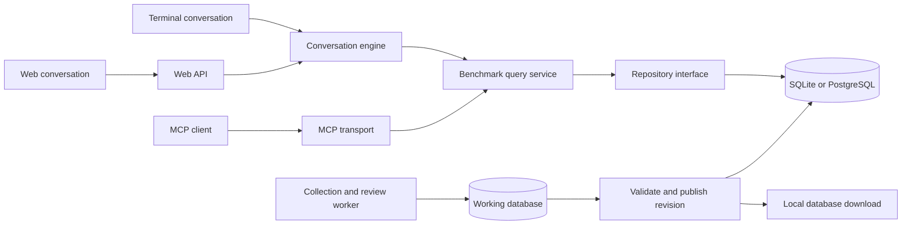

# Bench2Agent database and web service design

Bench2Agent will serve terminal conversations, MCP clients and a hosted web
conversation through the same benchmark tools. A relational database will hold
papers, benchmark identities, stated uses and their evidence. Collection runs
will add or revise records; agents will query a published data revision.

This is the implementation design, kept current. State as of 2026-10-13
(Bench2Agent 0.4.0 released; the checkout at 0.5.0.dev0): the application
reads an installed, immutable data revision, which is one SQLite database
identified by a hash of its research content (revisions installed by 0.4.0
from the JSON + SQLite bundle keep serving); the terminal, the stdio MCP
server and the optional HTTP MCP and web host all pin one revision per
conversation. The working database that will hold processing state is kept
apart from the published export (see *Next steps*).
`bench2agent serve` starts the local browser prototype. This design supports a
future Mac server and Linux deployment.

## Shared tools and separate interfaces

The query service owns benchmark identity, scope, counting, adoption and
evidence rules. Its responses retain the current six tool names and argument
schemas. An agent chooses tools and explains returned results; Python and SQL
compute the figures. The model does not receive unrestricted SQL access.

The repository interface supplies scoped paper observations, benchmark facts,
introduction claims and evidence; the SQLite repository implements it, and
the builder writes the same schema directly. A PostgreSQL adapter follows
when server write concurrency requires it. Counts and statistical comparisons
share one implementation, checked against fixture expectations and pinned
figures of published revisions (`scripts/regression_check.py`).

Both local and hosted answers carry the dataset revision, complete tool
arguments, analysed editions, denominators and evidence IDs. Every tool call
in a conversation uses its pinned revision, including follow-up questions and
answer verification. A new revision becomes available to new conversations;
existing conversations continue on their original revision.

## Database choices

| Deployment | Initial storage | Conditions for expansion |
|---|---|---|
| Installed terminal or local MCP | Read-only SQLite data bundle; local conversation files | No database server or additional runtime dependency |
| First hosted service on one Mac or Linux machine | SQLite research data; separate application store for users, sessions and jobs | Read-heavy research queries and a single publishing worker |
| Multiple collection writers or application servers | PostgreSQL for central metadata and application state; SQLite exports for local users | Concurrent writes, shared job coordination or several service instances |

The current corpus does not require PostgreSQL solely because it contains
tens of thousands of papers. SQLite supports local application storage and
server-side querying; many simultaneous writers are a reason to use a
client/server database. Keep SQLite files on local storage rather than a
network share. See [SQLite's deployment guidance](https://www.sqlite.org/whentouse.html).

Schema migrations and repository contracts must support both engines.
The terminal keeps its standard-library SQLite adapter. PostgreSQL drivers and
the web framework belong to optional server dependencies. Benchmark identity
and counting logic must not depend on a particular engine.

## Records and relationships

| Record | Essential fields and relationships |
|---|---|
| `papers` and `paper_identifiers` | Stable paper ID; title; external ID namespace and value, including arXiv, DOI, OpenReview and Anthology IDs; source-backed identity resolution |
| `paper_versions` | Paper ID, exact source version, URL, document hash, collection date, parser version and parsed artifact reference |
| `editions` and `paper_editions` | Venue, year, track, proceedings URL, edition dates when known, paper membership and source record ID |
| `paper_authors` | Original author spelling, order, normalization method; verified external identifiers when available; missing identity remains explicit |
| `benchmarks`, `benchmark_aliases` and `benchmark_relations` | Existing stable benchmark IDs, published names, sourced aliases, kind, settings, versions, homonyms and derived/subset relationships |
| `benchmark_uses` | Paper-version and observation scope, benchmark ID, evaluation/training role, resolution status, extraction/review run and supporting evidence links |
| `introduction_claims` and `reviews` | Claim ID, paper, benchmark, claim type, candidate/confirmed/excluded status, review method, rubric version and reason |
| `evidence` and `use_evidence` | Verbatim text or assembled table record, section/table location, source version, source hash, attached references and source offsets when available |
| `paper_labels` | Multiple domain/task labels, original label, declared or derived origin, vocabulary and classifier version |
| `resources` and `resource_checks` | Benchmark/paper owner, URL, host, artifact kind, paper-owned release versus maintained mapping, revision, check method, outcome and date |
| `ingestion_runs` and `paper_processing` | Stage, source, software/rule version, time, per-paper status, failure reason and retry state |
| `dataset_revisions` | Schema version, included extraction/review runs, creation date, content checksum and publication status |

A paper and its membership in a conference are separate records. One paper
can appear in multiple editions. Usage counts preserve paper-edition
observations; adoption counts deduplicate the stable paper identity as the
current tools do. Introduction dates distinguish first reviewed claim in this
corpus from independently established public release dates.

Names are not unique keys. Two products with the same name retain separate
benchmark IDs and introduction papers. Existing resolution decisions and
unattributed mentions survive import. Benchmark versions and settings remain
separate identities where the project's current identity rules require it.

Deduplicated evidence can support several uses through `use_evidence`.
The use relationship is stored independently of the displayed text. Removing
a duplicate quote or changing display limits must not remove the underlying
paper-benchmark-role relationship.

Collection retains all accepted paper records, including those without
arXiv matches or parsed text. Denominators come from processing status within
the requested scope. Importing the present snapshot preserves its aggregate
coverage and parsed observations; it cannot reconstruct missing papers or
source versions that the snapshot never recorded. Such fields remain unknown
until recovered from source records.

## Metadata for benchmark selection

After parity with existing counts is established, add sourced metadata for:

- The evaluation task, input/output formats, modalities and languages.
- Dataset size, answer/label format, official configurations and splits.
- Exact release revision, paper-specific subsets and preprocessing.
- Evaluation metrics, protocol, evaluation script and documented settings.

Each value includes its source and evidence. Prioritize recurring benchmarks
and reviewed introductions; report metadata coverage rather than treating
missing values as negative facts. Public repository access does not establish
that the exact evaluation records are downloadable.

Lexical search can use SQLite FTS5 or the server's search adapter. Semantic
retrieval can later return candidate paper IDs for an explicit research scope.
Counts are computed over that recorded scope; vector retrieval alone does not
establish benchmark use. Declared labels and derived task labels remain
distinguishable.

## Incremental collection and publication

1. Collect a venue edition through its source adapter, retaining source IDs,
   collection time, membership and collection coverage.
2. Resolve paper identities and versions. Queue missing or changed sources;
   transient fetch failures remain retryable rather than recorded as absence.
3. Parse and extract roles, claims and resource links. Store run versions and
   raw candidates separately from confirmed benchmark relationships.
4. Review new identities and ambiguous claims. Reprocess affected documents
   when a registry or rule update can change matches; adding an edition alone
   need not force a complete corpus rerun.
5. Validate counts, denominators, attribution and evidence. Publish one
   immutable revision atomically, then export its local SQLite bundle.

The working database can change while a published revision stays fixed.
Publication must prevent an answer from mixing partially imported editions or
different review revisions. Previous published data remains addressable for
saved conversations and regression checks.

## Hosted conversations

Use a separate ASGI web API, initially FastAPI with Uvicorn, for conversations
and streamed tool/answer events. It calls the same tools and the same
verifier as the terminal. Server dependencies are optional; terminal users do
not install the web stack. The existing local HTTP server remains the paper
evidence prototype during this transition.

**There is no Bench2Agent account** (owner decision, 2026-10-13): no sign-up,
invite code, name or password on any surface. A visitor opens the page and,
in Settings, connects their own Anthropic (Claude) or OpenAI account through
the provider's official sign-in. Two separate things: permission to use a
model comes from that connection (read without it, ask with it); ownership
of conversations comes from the anonymous visitor session, a cookie that ties
conversations to a browser. The session is not an account and never becomes
one. The same AI account in another browser does not recover conversations,
because the host never learns the account's identity. OpenAI is offered on the
web only once OpenAI approves remote hosting; until then it stays a terminal
connector. The API-key connector is an operator check option, not a visitor
path. Earlier invite and bearer-token users exist in the code as remnants
(`bench2agent web user|invite`) and are scheduled for removal; the web
store's `users` table also records the anonymous sessions' ownership of
conversations, which that removal preserves or migrates explicitly.

The hosted application keeps each visitor's conversations, limits and jobs
apart. A visitor's Claude Code runs in a runtime of its own (its own HOME and
config directory, an allowlisted environment); the official `claude auth
login` runs under a PTY relayed to that visitor only, and the host records
only the shape of the exchange, never its content. Today this is a
directory-isolation prototype under one OS user, not OS-user or container
isolation, and no real hosted sign-in has been performed yet. The operator's
own logins are never used for visitors.

Administrative collection and mutation endpoints are separated from the
read-only research tools. Cancellation, bounded requests and ordered
disconnect (stop jobs, official logout, remove the runtime) are implemented;
public access additionally needs HTTPS, supervision, backups and the
provider conditions in [account-connections.md](account-connections.md).

A long-running ingestion worker runs independently of HTTP requests and model
conversations. A database-backed job queue is enough initially; a separate
queue service is added only if load requires it. Tool responses are paginated,
and aggregate caches include the dataset revision and scope arguments.

## Account connections and the shared execution layer

`bench2agent.runtime` is the layer the web and the terminal share: a
connector reports its connection, points at the provider's own sign-in,
runs one question on one revision with progress and cancellation, and
returns the answer with the tool trail. Three connectors exist: the official
Claude Code binary and the official Codex CLI, each with the user's own
login and each owning its model/tool loop while Bench2Agent's pinned stdio
MCP server records every call, and a provider API key with Bench2Agent's own
loop. What each route permits, what was executed and what a public host can
offer is in [account-connections.md](account-connections.md).

## Where to run the private test host

The host is one FastAPI process plus a `/data` directory (installed data
revisions, and the web store with visitor sessions, conversations and
attempts). The `Dockerfile` packages exactly that, so any place that
runs a container with a persistent volume will do, and the same image moves
to the Mac later under Docker Desktop. What to check before choosing:

| Option | Persistence | Notes |
|---|---|---|
| This PC or a small Linux VPS, Caddy in front | local disk; back up `/data` | simplest; the `bench2agent web serve` process under a supervisor, or the container |
| Hugging Face Docker Space | the container disk is ephemeral; conversations and users vanish on restart unless the paid persistent storage is attached | fine for a short test if losing state is acceptable; sleeps when idle; a visitor connects their own Claude account; the operator's API key is an operator check option only |
| Mac server (later) | local volume | the same image; see below |

Whichever runs it: HTTPS termination in front (`BENCH2AGENT_WEB_SECURE_COOKIES=1`
then marks the session cookie Secure), the official Claude Code CLI installed
on the host for the visitors' runtimes, and `BENCH2AGENT_WEB_TURNS_PER_DAY`
and the runtime caps set to what the machine allows.

## Future Mac server

The Mac can host the API, query database, collection worker and web frontend.
When model inference uses provider APIs, these services do not require a local
GPU. Local model inference would be a separate capacity decision.

Use the same application on macOS or in a Linux virtual machine/container.
Container images must support the machine's CPU architecture; deployment
configuration must not hardcode Linux-only process management. Native macOS
services need a startup/restart supervisor; a container setup needs its runtime
to start after reboot. [Docker's Mac installation guide](https://docs.docker.com/desktop/setup/install/mac-install/)
describes the supported Mac distributions.

Place HTTPS termination in a reverse proxy such as Caddy, with only the web
application exposed. Keep database and worker endpoints internal. Public
reachability requires a domain and suitable routing or a tunnel, depending on
the network. [FastAPI's deployment concepts](https://fastapi.tiangolo.com/deployment/concepts/)
cover startup, restarts, process memory and HTTPS termination;
[Caddy](https://caddyserver.com/docs/automatic-https) documents certificate handling.

Store data on persistent local volumes and keep backups outside the serving
machine. Test restoring both research revisions and application state. SQLite
backups use its backup mechanism or frozen published files; PostgreSQL offers
[dump and continuous-archive options](https://www.postgresql.org/docs/current/backup.html).
Collection and model-call logs remain distinct from user-visible evidence.

## Implementation sequence

1. Import the present JSON snapshot into normalized SQLite tables without
   losing existing IDs, claims, evidence, unresolved mentions or coverage.
   **Done (2026-10-12):** `bench2agent data sqlite`, `core/repository.py`.
   The import reads back as the identical snapshot before it replaces the
   previous file; `meta` keeps `snapshot_id` (the extraction), `db_schema_version`
   (this layout) and `source_sha256` apart, and the file's own checksum is
   written beside it. Evidence rows are kept one per occurrence for now; the
   many-to-many `use_evidence` deduplication waits for revisions that carry
   evidence identities.
2. Add the repository interface and SQLite adapter; compare every existing
   tool result against the JSON implementation, including homonyms, unknown
   authors, zero adoption and duplicate paper membership.
   **Done (2026-10-12), since superseded (see *Next steps* 2):** `BenchmarkStore`
   computed every rule once over a JSON reference or the SQLite import,
   selected by `BENCH2AGENT_STORE`; parity was checked on fixtures and on
   the released snapshot (robotics 509 / LIBERO 80, SIMPLER 41, Meta-World
   29; ICLR CIFAR-10 178, 197, 165). From 2026-10-13 the database is the only
   backend and those figures are pinned in `scripts/regression_check.py`.
3. Add incremental edition ingestion and immutable data revisions. Verify
   rollback, repeat imports and saved-answer reproducibility.
   **Revisions done (2026-10-12):** `core/revisions.py` — immutable revision
   directories (`data/revisions/<snapshot_id>/` with JSON, SQLite, manifest)
   and an atomic, verified `active` pointer; no fallback to other files, and
   a broken pointer is a recovery error. `data install` stages and
   cross-checks both files before publishing; same content (`content_sha256`,
   without `generated_at`) under the same id reuses the installed copy;
   a damaged copy is restored only from bytes matching the original manifest.
   Every query runs on an explicit revision: a terminal question pins the one
   active when it starts (a saved conversation keeps its own), the local
   stdio MCP server pins the one active at process start (`--revision` to
   reproduce), and the conversation binding is a `ContextVar` (`mcp.using`),
   checked under threads and overlapping async tasks. The hosted HTTP MCP and
   web service will pass the conversation's revision explicitly per request.
   `bench2agent benchmarks --publish` turns a build into a revision. Not yet:
   per-paper processing status, retryable stage queues and partial
   reprocessing (the working database of this section).
   **HTTP MCP done (2026-10-12):** `core/mcp_http.py` with the official MCP
   Python SDK (`server` extra, `mcp>=2.3,<3`), Streamable HTTP, stateless:
   `/revisions/<id>/mcp` pins by path, `/mcp` pins to the process start,
   `/revisions` lists; outputs equal the repository reference on the same
   revision, overlapping conversations on two revisions stay apart, and a
   damaged or removed revision answers with recovery. `bench2agent mcp --http`.
4. Build the hosted conversation API and browser shell, with isolated user
   sessions and provider clients. Run the same representative question suite
   through terminal, MCP and HTTP.
   **First version done (2026-10-12):** `bench2agent web serve`
   (`web/app.py`, FastAPI/Uvicorn, `server` extra): bearer-token users with
   owned conversations, one revision per conversation routed to
   `/mcp-server/revisions/<id>/mcp`, request-scoped model credentials
   (`providers.using_credentials`, a ContextVar), cancellation, per-user
   limits, NDJSON progress then the verified turn, a minimal page. Tested
   over a real uvicorn server with a scripted provider: ownership on every
   route, v1 conversations after v2, two overlapping users, cancel saves
   nothing, failures echo no secret. Second pass (same day): service-
   credential mode fixed, job state machine (an accepted cancel is never
   followed by a save), attempts reserved atomically against the daily
   limit, internal bearer token on the mounted MCP, version-numbered
   conditional saves, safe link rendering, per-attempt timing. Not yet:
   public deployment (HTTPS, supervision, backups), token streaming,
   PostgreSQL.
5. Prepare Mac/Linux deployment and restore tests. Add PostgreSQL when measured
   write concurrency or multiple service instances justify it.

Paper2Agent informs the separation of executable tools, data resources and
workflow instructions. Bench2Agent applies that principle to benchmark
discovery across papers. Executing a selected benchmark's evaluation pipeline
is a later extension, with source revisions, input/output contracts and
reference-result tests per adapter. See the
[Paper2Agent paper](https://arxiv.org/abs/2509.06917v2).

## Next steps (agreed 2026-10-13)

1. Documentation aligned with the released state (this revision of the file).
2. **Done (2026-10-13):** SQLite is the only query backend and the revision
   is a database file. `build_revision` writes the research tables directly
   (no JSON round trip); the manifest (format v2) carries `db_schema_version`,
   `min_client_version`, the logical `content_sha256` and every file's
   checksum; the revision id is the content hash. The published file holds
   the research tables only (`repository.RESEARCH_TABLES`, checked at build);
   processing state, leases and conversations will live in a separate
   working database. Revisions installed by 0.4.0 keep serving; v1 bundles
   and legacy JSON install through a one-time import. Counting rules were
   not touched.
3. Identification rules in separate commits: paper identity from source ids
   with the title as a clue and raw rows preserved; benchmark identity from
   explicit evidence, author overlap as a flag and for self-use only; name
   corrections with an explicit reviewed target; label provenance recorded.
4. Incremental processing with per-paper stage status, re-runs that reach the
   downstream stages, and a scheduled update with catch-up and a run lock.
5. Revision retention: recent, active, referenced and in-use revisions are
   kept; leases live outside revision directories and share one lock with
   the delete decision.
6. The owner's private hosted sign-in check, in parallel.
7. Benchmark metadata at three levels and the first record adapters (GSM8K,
   MATH-500) with file-level verification and a retrieval manifest.
